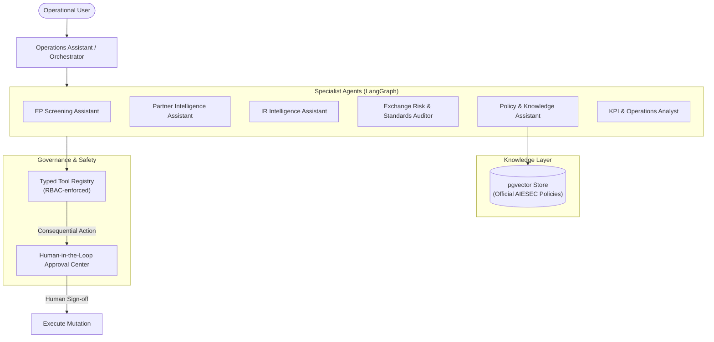

# AI Architecture & LangGraph Multi-Agent Governance

## 1. Multi-Agent Ecosystem

The AI subsystem operates as an operational copilot with bounded autonomy. Seven specialized agents collaborate through LangGraph:

## 2. Agent Specialization & Boundaries

1. **EP Screening Assistant**: Summarizes CVs, assesses JD alignment, drafts customized interview questions. *Boundary: Cannot accept or reject candidates.*
2. **Partner Intelligence Assistant**: Summarizes local organization profiles, estimates BANT parameters, drafts outreach in FR/EN. *Boundary: Cannot send communications autonomously.*
3. **IR Intelligence Assistant**: Analyzes international supply trends, compares past delivery with commitments, formats partnership briefs. *Boundary: Cannot make binding legal visa statements.*
4. **Exchange Risk & Standards Auditor**: Audits exchange checklists, checks mandatory standard deadlines, identifies at-risk milestones. *Boundary: Cannot waive standards or mark completion.*
5. **Policy & Legal Knowledge Assistant**: Answers operational questions using pgvector RAG, attaching exact document, section, and evidence citations (`[VERIFIED]`, `[OBSERVED]`, `[INFERRED]`). *Boundary: Cannot invent policy.*
6. **KPI & Operations Analyst**: Summarizes funnel conversions and SLA compliance with small-sample warnings. *Boundary: Read-only access through aggregated database views.*
7. **Operations Assistant (Orchestrator)**: Routes requests, manages run history, and prepares action payloads. *Boundary: Never possesses direct superuser or raw SQL capabilities.*

## 3. Human-in-the-Loop Approval Center

Consequential operations strictly require authenticated human approval:
- Changing official EXPA statuses.
- Accepting or rejecting EP applicants.
- Waiving any standard or extending grace periods.
- Approving pricing discounts, refunds, or payment milestones.
- Transmitting external communications (emails, WhatsApp, formal letters).
- Filing official Zendesk or ICB dispute cases.

If an action payload is modified after approval request creation, the existing approval token is invalidated, requiring re-submission.
