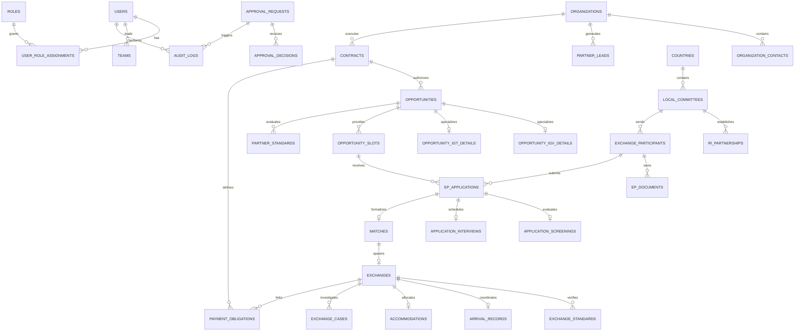

# Database Entity-Relationship Diagram (ERD)

## Schema Invariants & Conventions

1. **Primary Keys**: UUID v4 (`id UUID PRIMARY KEY DEFAULT gen_random_uuid()`).
2. **Timestamps**: All tables include `created_at TIMESTAMPTZ NOT NULL DEFAULT NOW()` and `updated_at TIMESTAMPTZ NOT NULL DEFAULT NOW()`.
3. **Actor Tracking**: Mutable tables include `created_by UUID REFERENCES users(id)` and `updated_by UUID REFERENCES users(id)`.
4. **Soft Deletion**: Applied via `deleted_at TIMESTAMPTZ` where operational auditing requires history retention.
5. **PII Masking**: EP passports, dates of birth, and personal phone numbers stored in restricted columns; access gated by RBAC.
6. **Optimistic Locking**: Critical concurrent tables (`opportunity_slots`, `payment_obligations`) use an integer `version` column for optimistic locking.
