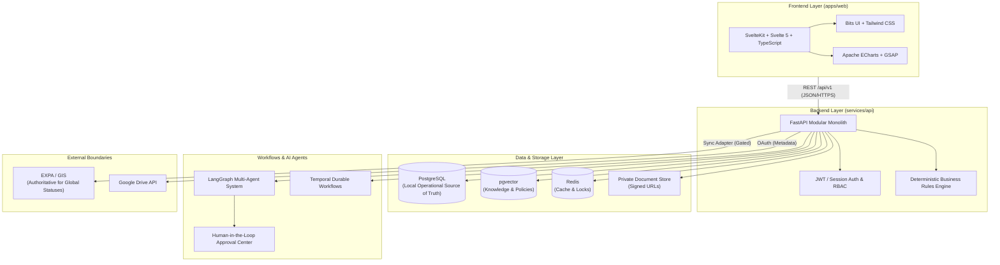
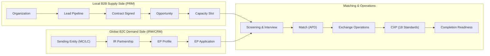

# System Architecture Overview

## 1. High-Level Architecture

The **AIESEC iCX Command Center** is structured as a robust **Modular Monolith**:
- **Frontend Application (`apps/web`)**: SvelteKit + Svelte 5 + TypeScript with Tailwind CSS and Bits UI. Strictly no React.
- **Backend API (`services/api`)**: Python 3.14 + FastAPI structured into domain-bounded modules (`identity`, `organizations`, `prm`, `irm`, `opportunities`, `crm`, `applications`, `exchanges`, `cxp`, `finance`, `tasks`, `analytics`, `ai`, `approvals`, `integrations`).
- **Database (`PostgreSQL`)**: Relational database serving as the local operational source of truth, enhanced with `pgvector` for embedding storage and similarity search.
- **Cache & Event Outbox (`Redis`)**: Fast caching, rate-limiting, and distributed locks for slot capacity allocation.
- **Workflow Automation (`Temporal`)**: Durable execution engine for operational SLA timers, reminder cascades, and background reconciliation.
- **AI Agent Orchestration (`LangGraph`)**: Stateful multi-agent graph with typed tools, provenance tracking, and explicit human approval checkpoints.

## 2. Core Operational Flow & The Two-Sided Marketplace

iCX connects local B2B hosting capacity with international EP demand at the application and matching junction:

## 3. Official EXPA Status vs Local Operational Readiness

The platform enforces a strict boundary between official global status and local operational readiness:
- **Official EXPA Status**: `APP` → `ACC` → `APD` → `RE` → `FI` → `CO` (plus exceptions: `REJ`, `WDR`, `BRK_APD`, `BRK_RE`, `EARLY_FI`, `LATE_FI`). EXPA is the authoritative record.
- **Local Operational Readiness**: `INCOMPLETE`, `READY_FOR_REVIEW`, `BLOCKED`, `AT_RISK`, `READY`, `IN_PROGRESS`, `DONE`, `WAIVED_WITH_APPROVAL`.
- **Invariant**: Local task completion never automatically triggers an EXPA mutation. Consequential status transitions require human review in the Approval Center.
